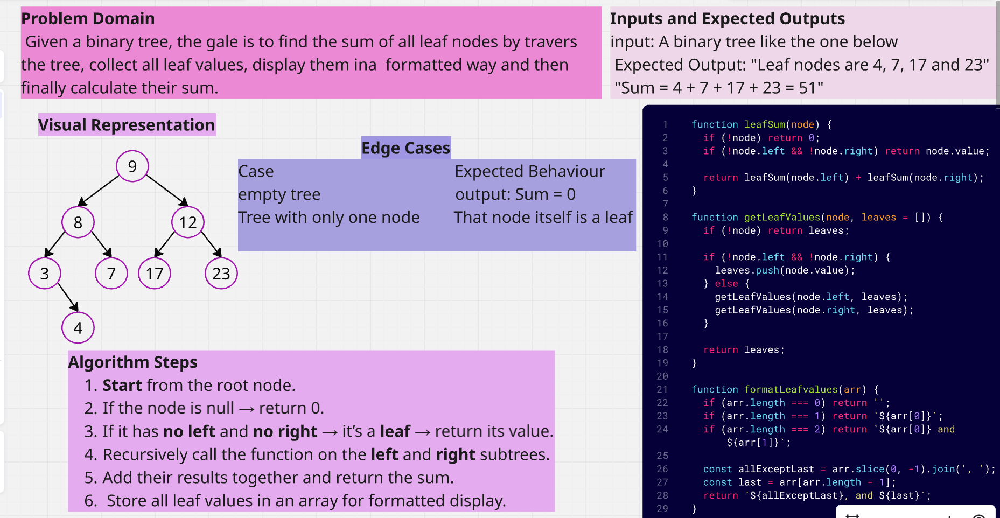

>>>>>>> Tree-Implementation

# Binary Tree - Sum of leaf nodes

# My Data Structures Repository

## Table of Contents 📑

### Data Structures
- **Trees**
  - [Binary Tree Implementation](./Data%20Structures/Trees/TreeImplementation/README.md)
  - [✅ Binary Tree Leaf Sum](./Data%20Structures/Trees/TreeImplementation/LeafSum/README.md)

### Algorithms
- [Sorting Algorithms](./Algorithms/Sorting/README.md)
- [Search Algorithms](./Algorithms/Search/README.md)